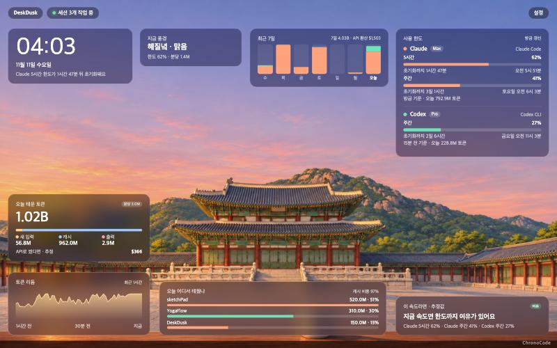
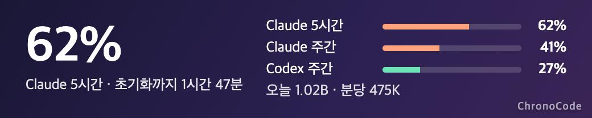

# DeskDusk

[한국어](README.md)

A desktop app that shows how much you have used your AI coding tools as a **landscape**. The fuller your limits get, the later the day becomes; the faster you burn tokens, the rougher the weather. You can read your status at a glance without reading numbers.

> A personal prototype (0.1.0), built and checked on macOS (Apple Silicon). The same file also contains an Intel build, checked under Rosetta (not on a real Intel Mac). The macOS release is signed with an Apple Developer ID and notarized. A Windows installer can be built too, but it has not been run on a real Windows machine and is unsigned, so installing it shows a warning.



Desktop widgets (scene and numbers, number strip):




Screenshots show the Korean UI with sample numbers and project names; the app also has an English UI.

## Download

Get it from the [releases page](../../releases/latest).

- **macOS (Apple Silicon and Intel)**: open `DeskDusk-0.1.0-universal.dmg` and drag DeskDusk into Applications. The file is notarized by Apple, so it opens right away.
- **Windows (x64)**: run `DeskDusk_0.1.0_x64-setup.exe`. It is not code-signed, so if SmartScreen warns you, choose "More info → Run anyway". The Windows build has not been tested much on real PCs.

On first launch one widget floats above your windows; use the menu bar (tray on Windows) icon to open the dashboard and toggle widgets.

## How it works

By default DeskDusk **never signs in to any service.** Claude Code and Codex write log files on your computer as you use them, and DeskDusk only reads those files.

```
Claude Code / Codex CLI ──(used as usual with your own account)──▶ Anthropic / OpenAI servers
        │
        │ writes logs on this computer every time
        ▼
  ~/.claude/projects/   ~/.codex/sessions/     ◀── DeskDusk reads only these
```

| What you want to see | Setup needed |
|---|---|
| Claude and Codex token usage, last 7 days, per project | None. Just open the app |
| Codex limits (%) | None. Codex writes its limits into the logs |
| Claude limits (%) | One-time connection, a single button under Settings → Connections |

Claude limits need a connection because Claude Code does not write them to its logs; it only passes them to its status line. The Connections panel opens once on first launch.

## What it shows

- **Usage limits** — Claude (5-hour and weekly, plus per-model weekly limits with the opt-in feature) and Codex usage and reset times
- **Tokens today** — new input, cache, and output, plus the rhythm of the last hour
- **Where it went today** — top three projects (working folders) and cache share
- **Last 7 days** — a stacked bar per day for Claude and Codex
- **If billed via API** — today's and the week's tokens converted at API list price (an estimate, not your subscription fee)
- **At this pace** — an estimate of when you will hit a limit at your average pace
- **11 scenes** — City, Sea, Blossom, Lake, Neon, Palace, Observatory, and four workspaces (Developer, Designer, Writer, Café). All react to usage.
- **4 kinds of weather** — rain, snow, dust, thunderstorm. "By season" follows the month.
- **Your own layout** — drag cards, resize them from the corner, lock them, hide the ones you do not need, and choose which services to show. Everything is in Settings and is kept between launches.
- **Desktop widgets** — small borderless windows shown on every desktop. You can open several, and right-clicking a widget lets you pick its shape (scene and numbers, number strip, scene only), what it shows, which services, and which scene. By default a widget floats above other windows; turn off "Keep on top" for a widget, or "Float widgets above windows" in the menu bar menu, to keep it on the desktop behind them (it still shows on top for about 3 seconds when you turn it on or move it). Drag to move; double-click to open the dashboard. These are not macOS system widgets from the widget gallery; toggle them in Settings or from the menu bar menu.
- **Menu bar summary** — the fullest limit of each service stays visible after you close the window ("Claude 26% · Codex 3%"). The Windows tray cannot show text, so the icon itself is drawn as the fullest limit's number (background in the service color) and hovering shows the full summary. If the icon sits in the overflow area (^), drag it onto the taskbar.
- **Limit alerts** — a notification when a limit passes 80% and 95%. Off by default; turn it on in Settings.
- **Korean and English** — switch in Settings. The first launch follows the system language.
- **Launch at login** — off by default. When enabled, it starts in the menu bar without opening the window.

## How the scene changes

| Value | Scene |
|---|---|
| Limit used, 0% → 100% | Early morning → Midday → Late afternoon → Dusk → Night |
| Burn rate, 100K → 5M tokens per minute | Calm → Clear → Cloudy → Drizzle → Rain (snow, dust, and storms follow the same steps) |

Without limit data the sky follows the real time of day. Try both values in Settings → Scene preview.

### Painted backgrounds

Day, dusk, night, and overcast paintings for all 11 scenes live in `src/assets/bg/` (made with OpenAI Codex image generation; OpenAI's terms assign rights in the output to the person who made it, and they are provided here under the same MIT license as the source. As AI-generated images, similar ones may exist elsewhere). As limits fill, the painting cross-fades from day to dusk to night; when you burn fast it moves to the overcast painting, and the weather effect is drawn on top.

To use your own, put `<scene>-day.jpg` or `.png` in the same folder. `-dusk`, `-night`, and `-overcast` are used when present. Scene names: `city`, `sea`, `sakura`, `lake`, `neon`, `palace`, `observatory`, `developer`, `designer`, `writer`, `barista`.

### About the API-equivalent cost

It is calculated from `src-tauri/pricing.json` (US dollars per million tokens). It is not what your subscription charges; it is the list price if the same usage had gone through the API. Cache writes are split into 5-minute and 1-hour caches. Long-context surcharges and batch discounts are not applied. Claude prices come from Anthropic's official pricing page and Codex prices from OpenAI's official pricing page (checked 2026-11-11). Models missing from the table are left out of the cost and listed under Data sources. When prices change, edit the file and rebuild.

## Where the data comes from

By default, only local logs on this computer. No credentials (keychain or auth files) are opened and nothing is sent over the network. The only exception is the opt-in "Fetch exact Claude limits" below.

| Value | Source |
|---|---|
| Claude tokens | session logs in `~/.claude/projects/` |
| Claude limits | the Claude Code status line (needs the bridge below), or values fetched from Anthropic when the opt-in feature is on |
| Codex tokens and limits | session logs in `~/.codex/sessions/` |
| Gemini, Grok | not supported yet (only shows whether they are installed) |

Limit values read from local logs are from **the last time you used each tool**, so they can be stale. The app shows how old they are.

### Connecting Claude limits

Open Settings → Connections → Connect Claude limits. The button does two things.

1. Places a small script at `~/.deskdusk/statusline.mjs`. It takes the values Claude Code passes to its status line, keeps only the limits, and writes them to `~/.deskdusk/claude-limits.json`. It makes no network calls (source: `scripts/claude-statusline-bridge.mjs`).
2. Registers that script under `statusLine` in `~/.claude/settings.json`. A backup named `settings.json.bak-deskdusk-<date>` is left next to it first, and no other setting is touched.

If you already use another status line it is not overwritten; call the script above from your own status line script instead. Node.js is required. Disconnect removes only the status line entry.

After connecting, use Claude Code in a terminal once to get the first value.

Known limitation: sessions in the Claude desktop app do not run the status line, so the values do not update there. If you mostly use the desktop app, turn on the opt-in feature below.

### Fetch exact Claude limits (opt-in, off by default)

The status line bridge only updates when you use Claude Code in a terminal, and it does not carry per-model weekly limits. If you mostly use the desktop app, the values drift. Turning on Settings → Connections → Fetch exact Claude limits does this:

- Reads the Claude Code login stored on this computer (the `Claude Code-credentials` keychain item on macOS, `~/.claude/.credentials.json` elsewhere) and asks `https://api.anthropic.com/api/oauth/usage` for your limits every 10 minutes. These are the same values as Claude Code's `/usage` screen.
- The login is used only for that request. It is never stored, logged, or modified (when it expires you are told to run Claude Code once).
- macOS asks whether to allow keychain access when you turn it on.
- Values are for the account signed in to terminal Claude Code, which may differ from the desktop app's account.
- This is not an officially documented endpoint and may change or stop working at any time.

## Build and run

You need Node.js and Rust, plus the Xcode command line tools on macOS, or the Visual Studio C++ build tools and WebView2 on Windows.

```bash
npm install
```

```bash
npm run dev
```

To build the macOS app bundle (`DeskDusk.app`):

```bash
npm run build
```

Build the Windows installer on Windows with the command below, or run this repository's `windows-build` GitHub workflow from the Actions tab.

```bash
npx tauri build --bundles nsis
```

A build you make yourself is ad-hoc signed, so on another Mac the first launch is blocked (allow it under System Settings → Privacy & Security → Open Anyway). To sign with your own Developer ID, set `APPLE_SIGNING_IDENTITY` to the certificate name when building, notarize the resulting dmg with `xcrun notarytool submit`, and attach the ticket with `xcrun stapler staple`. On Windows, choose More info → Run anyway on the SmartScreen warning.

### What launch at login does

On macOS, turning it on creates one file, `~/Library/LaunchAgents/dev.chronocode.deskdusk.autostart.plist`; turning it off deletes it. On Windows it adds or removes one value under `HKCU\Software\Microsoft\Windows\CurrentVersion\Run`. If you move the app, turn it off and on again.

```bash
/Applications/DeskDusk.app/Contents/MacOS/deskdusk --autostart status
```

## Tests

Automated tests for the core (log reading, deduplication, 7-day history, cost, limit connection, widget settings, parsing the server response; 42 tests):

```bash
cd src-tauri && cargo test --lib
```

Serve the `src` folder with any static server to see the UI with sample data. Add `?widget=1&shape=strip` to the address to see the widget shapes. Test results (in Korean) are in `Docs/Test-report-2026-11-10.md`.

## Known limitations

- Verified on macOS only. The code has Windows paths in place and `.github/workflows/windows-build.yml` builds an installer on GitHub's Windows runner, but it has not been run on a real Windows machine.
- Gemini CLI and Grok CLI are not supported yet.
- The first read can take a few seconds (about 4 seconds for 2.6 GB of logs from the last 7 days). After that only new lines are read.
- "Active sessions" counts log files written in the last 3 minutes, which can differ from what is really running.
- The pace estimate is a simple average and misses when your usage pattern changes.

## Third-party code

Tauri 2 with the official notification plugin (`tauri-plugin-notification`), `serde`, `chrono`, and `dirs`. All are MIT or Apache-2.0.

## Similar tools

Many good tools solve the same problem: [CodexBar](https://github.com/steipete/CodexBar), [OpenUsage](https://github.com/robinebers/openusage), [ccusage](https://github.com/ryoppippi/ccusage), and for ambience [Token Lounge](https://github.com/pyungjae9492/token-lounge-releases). DeskDusk focuses on one idea: usage changes the scenery.

A personal project, not affiliated with Anthropic, OpenAI, Google, or xAI. Claude, Codex, Gemini, and Grok are trademarks of their respective owners.

## License

MIT. See [LICENSE](LICENSE).
