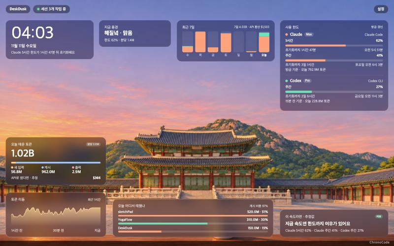
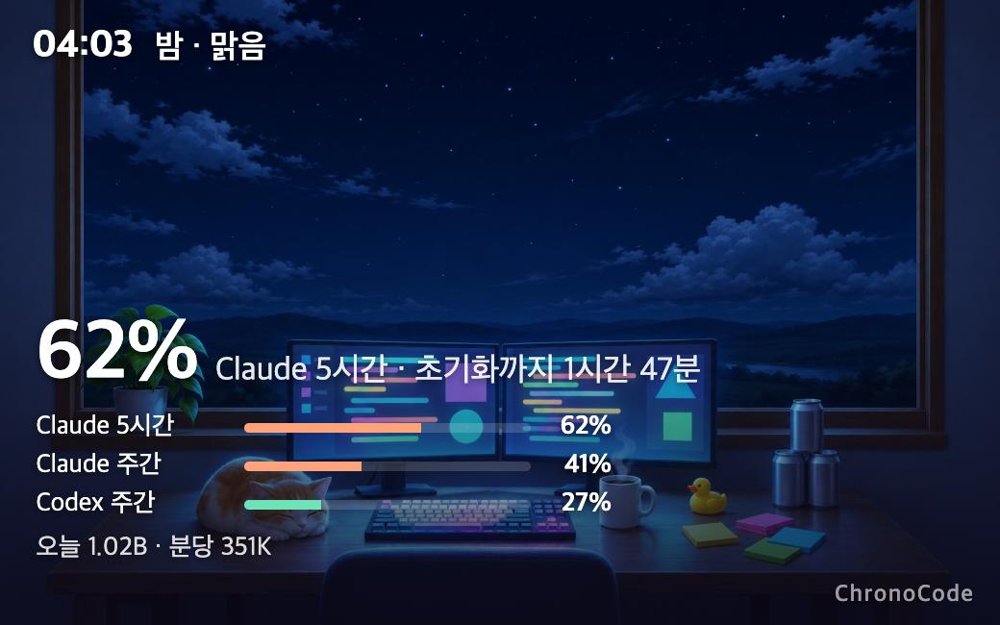
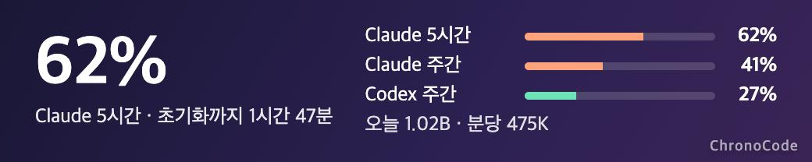

# DeskDusk (데스크 더스크)

[English](README.en.md)

AI 코딩 도구를 얼마나 썼는지를 **풍경**으로 보여주는 데스크톱 앱입니다. 한도가 찰수록 해가 지고, 빨리 태울수록 날씨가 거칠어집니다. 숫자를 읽지 않아도 곁눈으로 상태를 알 수 있습니다.

> 개인이 쓰려고 만든 시제품(0.1.0)입니다. 맥(Apple Silicon)에서 만들고 확인했습니다. 맥용 배포 파일은 Apple Developer ID로 서명하고 공증을 받았습니다. 윈도우용 설치 파일도 만들 수 있지만 실제 윈도우에서 실행해 본 적은 없고, 서명이 없어 설치할 때 경고가 뜹니다.



바탕화면 위젯(풍경과 숫자, 숫자 띠):





그림 속 숫자와 프로젝트 이름은 예시 값입니다.

## 내려받기

[릴리스 페이지](../../releases/latest)에서 받습니다.

- **맥(Apple Silicon)**: `DeskDusk-0.1.0-arm64.dmg`를 열어 DeskDusk를 「응용 프로그램」으로 끌어 놓습니다. Apple 공증을 받은 파일이라 바로 열립니다.
- **윈도우(x64)**: `DeskDusk_0.1.0_x64-setup.exe`를 실행합니다. 서명이 없는 파일이라 처음에 SmartScreen 경고가 나오면 「추가 정보 → 실행」을 누릅니다. 윈도우판은 실제 PC에서 충분히 확인하지 못했습니다.

처음 켜면 위젯 하나가 다른 창 위에 뜨고, 메뉴바(윈도우는 트레이) 아이콘에서 대시보드와 위젯을 켜고 끕니다.

## 어떻게 동작하나

DeskDusk는 기본 설정에서 **어느 서비스에도 로그인하지 않습니다.** Claude Code와 Codex는 쓸 때마다 이 컴퓨터에 기록 파일을 남기는데, DeskDusk는 그 파일을 읽을 뿐입니다.

```
Claude Code / Codex CLI ──(본인 계정으로 평소처럼 사용)──▶ Anthropic / OpenAI 서버
        │
        │ 쓸 때마다 이 컴퓨터에 기록을 남김
        ▼
  ~/.claude/projects/   ~/.codex/sessions/     ◀── DeskDusk는 여기만 읽음
```

| 보고 싶은 것 | 필요한 준비 |
|---|---|
| Claude·Codex 토큰 사용량, 최근 7일, 프로젝트별 | 없음. 앱만 켜면 됩니다 |
| Codex 한도(%) | 없음. Codex가 한도 값도 기록에 같이 적습니다 |
| Claude 한도(%) | 한 번 연결. 앱의 「설정 → 연결 상태」에서 버튼 하나로 합니다. 정확한 값을 원하면 같은 화면의 선택 기능을 켭니다 |

Claude 한도만 연결이 필요한 이유는 Claude Code가 한도 값을 기록에 남기지 않고 상태줄로만 내주기 때문입니다. 처음 실행하면 「연결 상태」 화면이 한 번 뜹니다.

## 보여주는 것

- **사용 한도** — Claude(5시간·주간, 선택 기능을 켜면 모델별 주간 한도까지), Codex의 사용률과 초기화 시각
- **오늘 태운 토큰** — 새 입력·캐시·출력 구분, 최근 1시간 리듬
- **오늘 어디서 태웠나** — 프로젝트(작업 폴더)별 상위 3개와 캐시 비중
- **이 속도라면** — 지금까지의 평균 속도로 추정한 한도 도달 시각
- **최근 7일** — 날마다 Claude·Codex가 태운 양을 막대로 보여줍니다.
- **API로 썼다면** — 오늘과 최근 7일의 토큰을 API 정가로 환산한 금액(추정값). 구독료가 아닙니다.
- **풍경 11종** — 도시, 바다, 벚꽃, 호수, 네온, 궁궐, 첨성대, 그리고 직업별 작업 공간(개발자, 디자이너, 작가, 카페). 모두 사용량에 반응합니다.
- **날씨 4종** — 비, 눈, 황사, 뇌우. 「계절 따라」로 두면 달에 맞춰 바뀝니다.
- **내 맘대로 배치** — 카드를 끌어 옮기고, 모서리를 끌어 크기를 바꾸고, 다 맞췄으면 「카드 고정」으로 잠그고, 필요 없는 카드는 끄고, 보고 싶은 서비스만 여러 개 골라 남길 수 있습니다. 모두 「설정」에 있고 다음 실행 때도 유지됩니다.
- **바탕화면 위젯** — 테두리 없는 작은 창이 모든 데스크톱에 떠 있습니다. 여러 개를 띄울 수 있고, 위젯을 오른쪽 클릭하면 위젯마다 모양(풍경과 숫자, 숫자 띠, 풍경만), 보여 줄 항목, 서비스, 풍경을 따로 고를 수 있습니다. 기본은 다른 창 위에 떠 있고, 위젯마다 「항상 위에 두기」를 끄거나 메뉴바 메뉴의 「위젯을 다른 창 위에 띄우기」를 끄면 다른 창 뒤 바탕화면에 깔립니다(이때도 켜거나 옮길 때는 3초쯤 위로 보입니다). 끌어서 옮기고 두 번 누르면 대시보드가 열립니다. macOS 위젯 갤러리에 나오는 시스템 위젯은 아니고, 설정이나 메뉴바 메뉴에서 켜고 끕니다.
- **메뉴바 요약** — 창을 닫아도 서비스마다 가장 많이 찬 한도가 보입니다(「Claude 26% · Codex 3%」). 설정에서 「가장 많이 찬 한도」 하나와 남은 시간으로 바꿀 수 있습니다. 윈도우 트레이에는 글자를 붙일 수 없어서, 가장 많이 찬 한도의 숫자가 아이콘에 그려지고(바탕색이 서비스 색) 마우스를 올리면 전체 요약이 나옵니다. 아이콘이 숨김 영역(^)에 들어가 있으면 작업 표시줄로 끌어내 두세요.
- **한도 경고 알림** — 한도가 80%, 95%를 넘으면 알려 줍니다. 설정의 「알림」에서 켜야 동작합니다(기본 꺼짐).
- **한국어·영어** — 설정의 「언어」에서 바꿉니다. 처음에는 시스템 언어를 따릅니다.
- **로그인할 때 자동 실행** — 「설정」에서 켜면 로그인할 때 창 없이 메뉴바에만 올라옵니다. 기본은 꺼짐입니다.

## 풍경이 변하는 규칙

| 값 | 풍경 |
|---|---|
| 한도 사용률 0% → 100% | 이른 아침 → 한낮 → 늦은 오후 → 해질녘 → 밤 |
| 태우는 속도(분당 10만 → 500만 토큰) | 고요 → 맑음 → 구름 → 가랑비 → 비 (눈·황사·뇌우도 같은 단계) |

한도 정보가 없으면 실제 시각으로 하늘을 정합니다. 「설정 → 풍경 미리보기」에서 두 값을 직접 움직여 볼 수 있습니다.

### 그림 배경

풍경 11종의 낮·노을·밤·흐린 날 그림이 `src/assets/bg/`에 들어 있습니다(OpenAI Codex의 이미지 생성으로 만든 그림. OpenAI 이용약관은 출력의 권리를 만든 사람에게 넘기며, 이 저장소에서는 소스와 같은 MIT 라이선스로 둡니다. AI가 만든 그림이라 비슷한 그림이 다른 곳에 있을 수 있습니다). 「설정 → 표시할 카드 → 그림 배경」으로 켜고 끕니다. 끄면 벡터로 그린 풍경이 나옵니다.

직접 바꾸려면 같은 폴더에 `<풍경>-day.jpg` 또는 `.png`를 넣으세요. `-dusk`(노을), `-night`(밤), `-overcast`(흐린 날)는 있으면 씁니다: 한도가 찰수록 낮 → 노을 → 밤 그림으로 서서히 바뀌고, 빨리 태우면 흐린 날 그림으로 넘어갑니다. 그림 위에 시간대 색과 날씨가 얹힙니다. 풍경 이름은 `city`, `sea`, `sakura`, `lake`, `neon`, `palace`, `observatory`, `developer`, `designer`, `writer`, `barista`입니다(궁궐부터는 그림만 있는 풍경). 없는 시간대는 낮 그림에 색을 입혀 표현합니다.

### API 환산 비용에 대해

`src-tauri/pricing.json`의 요금표(100만 토큰당 달러)로 계산합니다. 구독 요금제의 실제 청구액이 아니라, 같은 양을 API로 썼다면 들었을 정가입니다. 캐시 쓰기는 5분 캐시와 1시간 캐시를 나눠 계산하고, 긴 문맥 할증과 일괄 처리 할인은 반영하지 않습니다. Claude 요금은 Anthropic 공식 요금표, Codex 요금은 OpenAI 공식 요금 페이지에서 가져왔습니다(2026-11-11 확인). 요금표에 없는 모델은 비용에서 빠지고 「값의 출처」에 이름이 나옵니다. 요금이 바뀌면 이 파일을 고쳐 다시 빌드하세요.

## 값을 어디서 읽나

기본 설정에서는 이 컴퓨터의 기록만 읽습니다. 로그인 정보(키체인·인증 파일)는 열지 않고, 인터넷으로 보내는 것도 없습니다. 아래 「정확한 Claude 한도 가져오기」를 직접 켰을 때만 예외입니다.

| 값 | 출처 |
|---|---|
| Claude 토큰 | `~/.claude/projects/` 의 세션 기록 |
| Claude 한도 | Claude Code 상태줄 값(아래 연결 필요). 선택 기능을 켜면 Anthropic 서버에서 직접 받은 값 |
| Codex 토큰·한도 | `~/.codex/sessions/` 의 세션 기록 |
| Gemini, Grok | 아직 지원하지 않음(설치 여부만 표시) |

로컬 기록에서 읽은 한도 값은 각 도구를 **마지막으로 쓴 시점의 값**입니다. 그 뒤로 쓰지 않았다면 실제와 다를 수 있어, 화면에 「n분 전 기준」을 함께 보여줍니다.

### Claude 한도 연결

앱의 「설정 → 연결 상태 → Claude 한도 연결하기」를 누르면 됩니다. 버튼이 하는 일은 두 가지입니다.

1. 작은 스크립트를 `~/.deskdusk/statusline.mjs`에 둡니다. Claude Code가 상태줄을 그릴 때 넘겨주는 값에서 한도만 꺼내 `~/.deskdusk/claude-limits.json`에 적는 스크립트이고, 네트워크 호출은 없습니다(원본: `scripts/claude-statusline-bridge.mjs`).
2. `~/.claude/settings.json`의 `statusLine` 항목에 그 스크립트를 등록합니다. 바꾸기 전에 같은 폴더에 `settings.json.bak-deskdusk-<날짜>`로 백업을 남기고, 다른 설정은 건드리지 않습니다.

이미 다른 상태줄을 쓰고 있으면 덮어쓰지 않습니다. 그때는 쓰던 상태줄 스크립트에서 위 스크립트를 함께 부르도록 직접 연결하세요. Node.js가 필요합니다. 「연결 끊기」를 누르면 상태줄 항목만 지웁니다.

연결한 뒤에는 터미널에서 Claude Code를 한 번 써야 첫 값이 들어옵니다.

알려진 한계: Claude 데스크톱 앱의 세션에서는 상태줄이 실행되지 않아 값이 갱신되지 않습니다. 데스크톱 앱 위주로 쓴다면 아래 선택 기능을 켜세요.

### 정확한 Claude 한도 가져오기 (선택 기능, 기본 꺼짐)

상태줄 연결은 터미널에서 Claude Code를 쓸 때만 값이 바뀌고, 모델별 주간 한도는 받지 못합니다. 데스크톱 앱 위주로 쓰면 값이 실제와 달라집니다. 「설정 → 연결 상태 → 정확한 Claude 한도 가져오기」를 켜면 이렇게 동작합니다.

- 이 컴퓨터에 저장된 Claude Code 로그인 정보(맥은 키체인의 `Claude Code-credentials`, 그 밖은 `~/.claude/.credentials.json`)를 읽어 `https://api.anthropic.com/api/oauth/usage`에 10분마다 한도를 묻습니다. Claude Code의 `/usage` 화면과 같은 값입니다.
- 로그인 정보는 그 요청에만 쓰고 저장하거나 기록하지 않습니다. 고치지도 않습니다(만료되면 Claude Code를 한 번 실행하라고 안내합니다).
- 켤 때 macOS가 키체인 접근을 허용할지 물어봅니다.
- 터미널 Claude Code에 로그인된 계정의 값이 나옵니다. 데스크톱 앱과 다른 계정으로 로그인돼 있으면 그 계정의 값입니다.
- Anthropic이 공식으로 문서화한 경로가 아니라 언제든 바뀌거나 막힐 수 있습니다.

## 빌드·실행

필요한 것: Node.js, Rust, 그리고 맥은 Xcode 명령줄 도구, 윈도우는 Visual Studio C++ 빌드 도구와 WebView2.

```bash
npm install
```

```bash
npm run dev
```

맥 앱 묶음(`DeskDusk.app`)을 만들려면:

```bash
npm run build
```

윈도우 설치 파일은 윈도우에서 아래 명령으로 만들거나, 이 저장소의 깃허브 작업 흐름 `windows-build`(Actions 탭에서 직접 실행)로 만듭니다.

```bash
npx tauri build --bundles nsis
```

직접 빌드하면 임시 서명이라 다른 Mac에서는 처음 열 때 막힙니다(「시스템 설정 → 개인정보 보호 및 보안」에서 「그래도 열기」). 본인의 Developer ID로 서명하려면 빌드할 때 환경 변수 `APPLE_SIGNING_IDENTITY`에 인증서 이름을 넣고, 만들어진 dmg를 `xcrun notarytool submit`으로 공증받은 뒤 `xcrun stapler staple`로 붙입니다. 윈도우에서는 「Windows의 PC 보호」 경고에서 「추가 정보 → 실행」을 누릅니다.

### 자동 실행이 하는 일

맥에서는 켜면 `~/Library/LaunchAgents/dev.chronocode.deskdusk.autostart.plist` 파일 하나를 만들고, 끄면 지웁니다. 윈도우에서는 사용자 시작 프로그램 등록(`HKCU\Software\Microsoft\Windows\CurrentVersion\Run`)에 값 하나를 넣고 뺍니다. 앱을 다른 곳으로 옮겼다면 껐다가 다시 켜세요. 명령줄에서도 확인할 수 있습니다.

```bash
/Applications/DeskDusk.app/Contents/MacOS/deskdusk --autostart status
```

## 시험

본체의 자동 시험(로그 읽기, 중복 제거, 7일 기록, 비용, 한도 연결, 위젯 설정, 서버 응답 읽기 등 42개):

```bash
cd src-tauri && cargo test --lib
```

화면은 `src` 폴더를 정적 서버로 띄우면 예시 값으로 볼 수 있습니다. 주소 끝에 `?widget=1&shape=strip`처럼 붙이면 위젯 모양도 볼 수 있습니다. 시험 결과는 `Docs/Test-report-2026-11-10.md`에 있습니다.

## 알려진 한계

- 맥에서만 확인했습니다. 윈도우용은 코드를 맞춰 두었고 깃허브 빌드 서버(`.github/workflows/windows-build.yml`)에서 설치 파일을 만들 수 있지만, 실제 윈도우에서 실행해 본 적은 없습니다.
- Gemini CLI와 Grok CLI는 아직 지원하지 않습니다. 선택 항목과 자리만 있습니다.
- 첫 읽기는 기록 크기에 따라 몇 초 걸릴 수 있습니다(최근 7일 기록 2.6GB에서 4초 정도). 이후에는 바뀐 부분만 읽습니다.
- 「작업 중 세션」은 최근 3분 안에 기록이 붙은 세션 수라, 실제 실행 중인 수와 다를 수 있습니다.
- 소진 예측은 단순 평균이라 사용 패턴이 바뀌면 빗나갑니다.

## 쓰는 외부 코드

Tauri 2와 공식 알림 플러그인(`tauri-plugin-notification`), `serde`, `chrono`, `dirs`. 모두 MIT 또는 Apache-2.0 라이선스입니다.

## 비슷한 도구

같은 문제를 푸는 좋은 도구가 많습니다: [CodexBar](https://github.com/steipete/CodexBar), [OpenUsage](https://github.com/robinebers/openusage), [ccusage](https://github.com/ryoppippi/ccusage), 분위기형으로는 [Token Lounge](https://github.com/pyungjae9492/token-lounge-releases). DeskDusk는 「사용량이 풍경을 바꾼다」는 한 가지에 집중합니다.

Anthropic, OpenAI, Google, xAI와 관계없는 개인 프로젝트입니다. Claude, Codex, Gemini, Grok은 각 회사의 상표입니다.

## 라이선스

MIT. [LICENSE](LICENSE)를 보세요.
